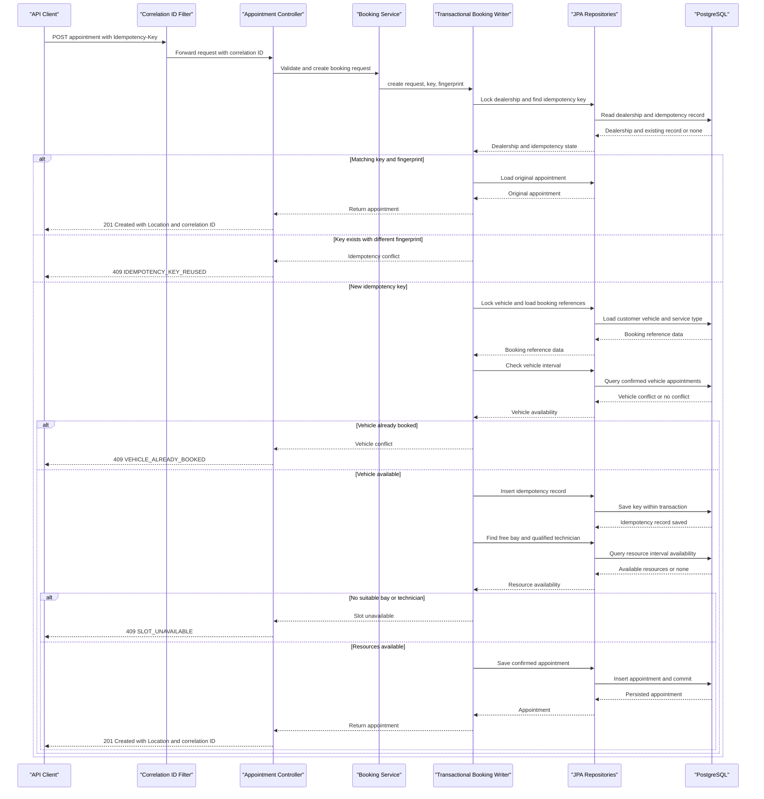

# API & Service Communication Contracts

The application exposes five versioned REST endpoints for catalog, resource, and appointment operations. Requests are synchronous; there are no external service calls, message broker, or asynchronous booking flow.

## Service Catalog

| Service | Port | Category | Purpose |
|---|---:|---|---|
| Unified Service Scheduler (`service-scheduler`) | 8080 | API Layer / Business | Serves the appointment REST API and coordinates booking use cases. |
| PostgreSQL (`db`, `postgres:16-alpine`) | 5432 (Compose network) | Infrastructure | Persists appointments, idempotency records, and reference data. |

## API Endpoints Inventory

| Service | Method | Path | Request Type | Response Type |
|---|---|---|---|---|
| Unified Service Scheduler | POST | `/api/v1/appointments` | `BookingRequest` JSON body; required `Idempotency-Key` header | `AppointmentResponse`; `201`, `400`, `404`, or `409` |
| Unified Service Scheduler | GET | `/api/v1/appointments` | Optional `page` (default 0), `size` (default 20, maximum 100) query parameters | `PageResponse<AppointmentResponse>`; `200` or `400` |
| Unified Service Scheduler | GET | `/api/v1/appointments/{appointmentId}` | `appointmentId` path parameter | `AppointmentResponse`; `200` or `404` |
| Unified Service Scheduler | GET | `/api/v1/service-types` | None | JSON array of `ServiceTypeResponse`; `200` |
| Unified Service Scheduler | GET | `/api/v1/dealerships/{dealershipId}/resources` | `dealershipId` path parameter | `ResourceSummary`; `200` or `404` |

All application endpoints use URL path versioning (`/api/v1`). Error responses use an `ApiError` body with a stable code and message.

## Management & Observability Endpoints

| Service | Endpoint | Custom Metrics |
|---|---|---|
| Unified Service Scheduler | `/actuator/health`, `/actuator/health/readiness`, `/actuator/health/liveness` | Health and probe status |
| Unified Service Scheduler | `/actuator/info` | Build/application information when configured |
| Unified Service Scheduler | `/actuator/metrics` | Lists available Micrometer metrics |
| Unified Service Scheduler | `/actuator/metrics/scheduler.application.operation` | `scheduler.application.operation`, tagged with bounded `operation` and `outcome` values |

The configured Actuator exposure includes health, info, and metrics. The application does not currently export metrics to Prometheus or traces to an OpenTelemetry backend. Developer API documentation is available at `/swagger-ui/index.html`, which loads the static Swagger 2.0 contract from `/openapi.yaml`; these are documentation resources, not business API operations.

## DTOs & Contracts

- `BookingRequest` is the appointment creation request body.
- `AppointmentResponse` is the appointment representation returned by booking and retrieval endpoints.
- `PageResponse<AppointmentResponse>` wraps paginated appointment results and page metadata.
- `ServiceTypeResponse` represents service catalog entries.
- `ResourceSummary` represents dealership service bays and technicians.
- `ApiError` represents stable error responses.

These are API-level transport models; the project does not define gateway aggregation DTOs. Response DTO fields are final where applicable, while request `BookingRequest` is mutable for Jackson deserialization. JSON serialization/deserialization uses Spring Boot's Jackson integration. The OpenAPI 2.0 (Swagger 2.0) contract is maintained in [`openapi.yaml`](../../../../../openapi.yaml) and served as a static resource at `/openapi.yaml`; Swagger UI at `/swagger-ui/index.html` loads this contract for interactive API documentation.

## Communication Patterns

- **Synchronous communication:** The caller invokes the scheduler over HTTP. Controllers call application services directly; services call Spring Data JPA repositories, which access PostgreSQL in-process through the configured datasource.
- **Asynchronous communication:** None. No message broker, event publisher, outbox, or background consumer is implemented.
- **Retries and resilience:** No HTTP downstream calls, circuit breaker, or automatic API retry policy is configured. Clients may safely retry a booking with the same `Idempotency-Key`; a changed request with the same key returns `409 IDEMPOTENCY_KEY_REUSED`.
- **Concurrency:** Booking uses a PostgreSQL transaction and pessimistic row locks for dealership and vehicle records. The idempotency record and appointment are persisted in the same transaction.
- **Gateway and service discovery:** No API gateway or service discovery component is implemented. Docker Compose service DNS is used for the app-to-database connection in the local stack.
- **Security posture:** Application authentication and authorization are not implemented. Compose publishes the API over local HTTP; TLS is not configured in this assessment. Production deployment must add HTTPS and enforce dealership/customer authorization.

## Service Technology Matrix

| Service | Web | Data Access | Discovery | Gateway | Actuator | Cache | Metrics |
|---|---|---|---|---|---|---|---|
| Unified Service Scheduler | Spring MVC | Spring Data JPA / Hibernate | None; Compose DNS for local DB | None | Health, info, metrics | In-process reference-data cache | Micrometer timer; no external exporter |
| PostgreSQL | N/A | PostgreSQL database | Compose DNS | N/A | Container health check | N/A | Database/container metrics not exported by this project |

## Service Communication Sequence

<!-- mermaid-checked: every participant uses `participant Id as "Label"`, no \n in aliases/messages/notes, every alt/opt/loop closed by end, no `:` inside any alias -->

