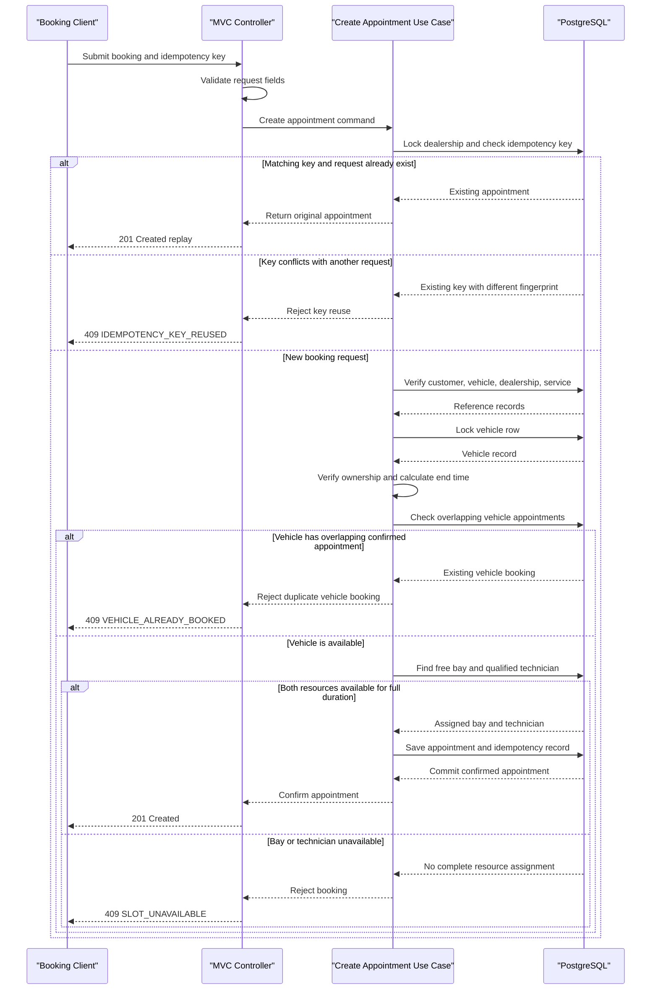

# Core Business Workflows

The Unified Service Scheduler helps dealership staff confirm vehicle service appointments against both bay capacity and technician qualifications. Its primary workflow reserves the needed resources together so a customer receives a confirmed appointment or a clear conflict response.

## Domain Entities

| Entity | Service / Bounded Context | Description | Key Relationships |
|---|---|---|---|
| Dealership | Appointment Scheduling | Location that owns service capacity and handles booking requests. | Owns service bays and technicians; appointments are booked at a dealership. |
| Customer | Customer Ownership | Person requesting service. | Owns vehicles and is associated with appointments. |
| Vehicle | Customer Ownership | Customer vehicle to be serviced. | Belongs to one customer and is referenced by appointments. |
| ServiceType | Service Catalog | Kind of work requested, with a standard duration. | Determines appointment length and technician qualification. |
| ServiceBay | Workshop Capacity | Physical resource where work is performed. | Belongs to a dealership and is assigned to an appointment. |
| Technician | Workshop Capacity | Staff member who performs service work. | Belongs to a dealership, has service qualifications, and is assigned to appointments. |
| TechnicianService | Workshop Capacity | Qualification relationship between technicians and service types. | Connects a technician to service types they are qualified to perform. |
| Appointment | Appointment Scheduling | Confirmed reservation connecting customer, vehicle, service, and assigned resources. | References one dealership, customer, vehicle, service type, bay, and technician. |
| IdempotencyRecord | Appointment Scheduling | Persistent record that makes a repeated booking request return the original appointment. | Key/fingerprint associates a client retry with its appointment. |

## Service-to-Domain Mapping

| Service | Domain Context | Owned Entities | External Dependencies |
|---|---|---|---|
| Scheduler application (modular monolith) | Appointment Scheduling | Appointment, IdempotencyRecord | PostgreSQL in Compose; dealership/customer/vehicle and service master data are seeded for this demo. |
| Scheduler application (modular monolith) | Workshop Capacity | ServiceBay, Technician, TechnicianService | No external service in the current implementation. |
| Scheduler application (modular monolith) | Customer Ownership / Service Catalog | Customer, Vehicle, ServiceType | These are local demo/master-data records; production ownership should be clarified with upstream systems. |

There are no separately deployed business services in this implementation. The contexts share the scheduler database; REST is the client-facing interaction, and no cross-service event flow is currently implemented.

## Primary Workflows

### Workflow 1: Booking a Service Appointment

1. A client submits an appointment request with an idempotency key and an offset-aware start time.
2. The REST adapter validates the request and invokes the create-appointment use case.
3. The application opens a database transaction and locks the dealership row, then the vehicle row, to serialize dealership resource allocation and bookings for the same vehicle across dealerships.
4. It checks whether the idempotency key already exists. The same payload returns its original appointment; a different payload is rejected.
5. It verifies the dealership, customer, vehicle, and service type exist and verifies that the vehicle belongs to the customer.
6. It computes the end time from the service type duration, rejects any overlap with a confirmed appointment for the same vehicle, then searches for an available service bay and qualified technician for the complete interval.
7. If both resources are available, it persists the confirmed appointment and idempotency record atomically.
8. The client receives the confirmed appointment. A resource conflict returns a conflict response and rolls back the idempotency claim.

### Workflow 2: Reading Scheduler Reference Data

The client requests service types or dealership resources. The scheduler returns the catalog/reference response (which may be served from a short-lived cache). Reference-data reads are separate from booking availability checks; live availability is always checked against persistent appointments during booking.

## Cross-Service Data Flows

No separate services or cross-service data aggregation flows currently exist. The scheduler reads demo/master-data records and appointment state from its persistence layer. The booking operation is synchronous so its caller receives a definitive outcome. If notifications or downstream integrations are added, emit a confirmed-appointment event only after commit; a transactional outbox is recommended to avoid publishing events for rolled-back appointments.

## Business Workflow Sequence

<!-- mermaid-checked: every participant uses `participant Id as "Label"`, no \n in aliases/messages/notes, every alt/opt/loop closed by end, no `:` inside any alias -->

## Business Rules & Decision Logic

- Booking requests require a dealership, customer, vehicle, service type, future start time, and idempotency key.
- The selected vehicle must belong to the requested customer.
- Service duration comes from the requested service type; appointment intervals are treated as half-open, so adjacent appointments do not overlap.
- A confirmed booking requires both a free bay at that dealership and a free technician qualified for the service across the complete interval.
- A vehicle cannot have overlapping confirmed appointments, even across different dealerships. A pessimistic vehicle-row lock serializes competing requests before the overlap query.
- Existing confirmed appointments reserve their bay and technician. A conflict with either resource rejects the booking.
- Matching idempotency key plus matching normalized request returns the original appointment; same key with a different payload is rejected.
- Appointment and idempotency record persist atomically. Failed bookings do not retain an idempotency claim.
- The dealership-then-vehicle lock order serializes resource allocation and vehicle scheduling; future update/cancel workflows must follow the same lock order.
- Appointment state currently includes `CONFIRMED` and `CANCELLED`, but cancellation and rescheduling workflows are not exposed by the REST API.
- There is no authorization implementation yet; production access must enforce dealership and customer ownership boundaries.
