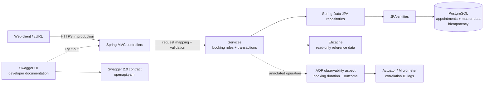
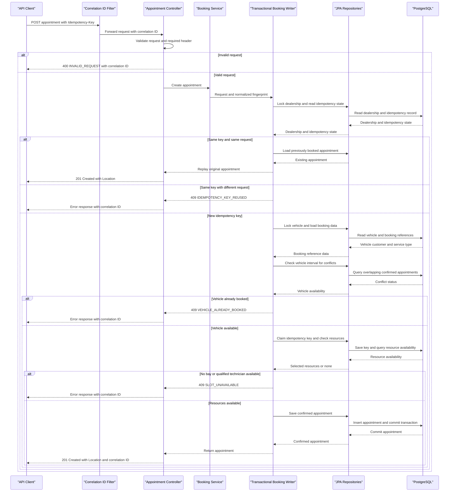

# Scenario A — Unified Service Scheduler

## Problem and scope

Replace manual service booking with a backend that confirms an appointment only when both a service bay and a technician qualified for the selected service are free for the entire requested duration. The implementation is the backend option from the assessment; the client is represented by REST/cURL.

### Assumptions

1. A service type defines one fixed duration. The customer requests a start time, not an end time.
2. A vehicle belongs to exactly one customer. The requested customer must own the requested vehicle.
3. Service bays and technicians belong to one dealership. Service qualifications are explicit.
4. All intervals are half-open: `[start, end)`. Appointments that meet exactly at an end/start boundary do not overlap.
5. Only `CONFIRMED` appointments reserve resources. The current API does not expose cancellation or rescheduling.
6. Incoming times must include an ISO-8601 offset. They are normalized to `Instant` and stored using UTC JDBC time-zone configuration. The dealership's IANA zone is metadata for a future client/display layer.
7. PostgreSQL is the only supported database. Master data is managed upstream in production; demo fixtures are loaded for local assessment runs.
8. Idempotency keys are retained persistently in this implementation. A production retention policy must be agreed with API consumers before old keys are purged.
9. Authentication and authorization are outside this assessment implementation. Production booking and read APIs must enforce customer/dealership scope.

## Architecture

The application is a modular monolith using a conventional MVC layered structure: controllers handle HTTP, services implement use-case orchestration and transactions, Spring Data repositories perform persistence operations, and JPA entities map to database tables. The transactional writer owns the atomic resource check/write. Services depend directly on repository interfaces; there are no separate application ports or persistence adapter wrappers.

The domain objects are plain Java classes in `domain/`, while persistence-only JPA entities live in `entity/`. `JpaEntityMapper` translates between those models. This keeps domain values separate from Hibernate mappings without introducing port/adapter indirection. Spring service and transaction annotations are used directly in the service layer.

## Components

| Component | Responsibility |
|---|---|
| `controller/AppointmentController` | Versioned REST surface, request validation, status/Location response |
| `exception/ApiExceptionHandler` and domain exceptions | Converts known exceptions into stable API error responses |
| `BookingService` | Request fingerprinting and idempotency replay handling |
| `TransactionalBookingWriter` | Transaction boundary, dealership lock, eligibility and availability checks, atomic persistence |
| `AppointmentQueryService` | Appointment retrieval use case |
| `ServiceCatalog` | Service type and dealership resource read endpoints |
| `service/` | Coordinates business operations and transactions; directly uses repository interfaces |
| `repository/` | Spring Data JPA data access, deterministic resource selection, and overlap queries |
| `entity/` | Hibernate/JPA persistence mappings, kept separate from business domain objects |
| `JpaEntityMapper` | Converts between persistence entities and plain domain objects |
| `dto/` | HTTP request and response data transfer objects; separate from JPA entity mappings |
| Flyway | Versioned schema creation; demo fixtures are isolated from the PostgreSQL schema migration path |
| Ehcache | Five-minute local cache for service type and dealership resource reference endpoints only |
| `controller/CorrelationIdFilter` | Validates or generates `X-Correlation-ID`, echoes it in the response, and places it in log MDC |
| `OperationMetricsAspect` | AOP advice times annotated application operations and records bounded `operation`/`outcome` tags |
| Spring Boot Actuator / Micrometer | Health and HTTP/JVM/application metrics at `/actuator/health` and `/actuator/metrics` |
| Swagger UI | Developer-facing API explorer at `/swagger-ui/index.html`; loads the static Swagger 2.0 contract at `/openapi.yaml` |

## Booking data flow

1. The client calls `POST /api/v1/appointments` with a required `Idempotency-Key` and dealership, customer, vehicle, service type, and offset-aware start time.
2. The controller validates request fields. The application service fingerprints the normalized request values.
3. In a database transaction, the writer locks the dealership row and then the vehicle row with `PESSIMISTIC_WRITE`. The dealership lock serializes resource allocation at that location; the vehicle lock serializes overlapping bookings for the same vehicle even when they target different dealerships. All booking flows use dealership-then-vehicle lock order.
4. The writer checks for a prior idempotency record. A matching fingerprint returns the original appointment; a different payload with the same key is rejected.
5. It loads the referenced records, confirms vehicle ownership, and derives `endAt = startAt + service duration`.
6. It rejects the booking if the vehicle already has an overlapping confirmed appointment, then selects a bay and a qualified technician in deterministic ID order. A resource conflicts when `existing.start < requested.end AND existing.end > requested.start`; therefore the check covers the whole duration.
7. Before committing, it inserts the idempotency record and confirmed appointment in the same transaction. The database primary key on the idempotency key handles duplicate submissions that race across different dealership locks.
8. On success, the API returns `201 Created`, the appointment representation, and a `Location` header. Resource conflicts return `409`; a successful retry replays the original representation.

The idempotency record and appointment commit atomically: a failed booking rolls back the key claim too. Dealership and vehicle row locks make the read-check-write sequence safe under PostgreSQL's normal `READ COMMITTED` isolation for application-originated bookings. The overlap query is supported by an index on vehicle, status, and interval fields. All database integration tests use PostgreSQL Testcontainers so functional and concurrency checks exercise the selected database.

### Booking sequence diagram

The sequence below shows the synchronous booking path, including idempotency replay, conflict responses, and the transaction that persists a successful booking.

<!-- mermaid-checked: every participant uses `participant Id as "Label"`, no \n in aliases/messages/notes, every alt/opt/loop closed by end, no `:` inside any alias -->

## API contract

The project uses **RESTful HTTP APIs** for operations where the caller needs an immediate result: service/resource queries and booking confirmation or conflict. The `Idempotency-Key` protects retried booking requests. Paths are resource-oriented, versions are explicit (`/api/v1`), and HTTP status codes distinguish created, invalid, missing, and conflicting requests.

| Method | Path | Purpose |
|---|---|---|
| `GET` | `/api/v1/service-types` | List service types and durations |
| `GET` | `/api/v1/dealerships/{dealershipId}/resources` | List dealership bays and technicians |
| `GET` | `/api/v1/appointments?page=0&size=20` | List appointments using bounded pagination |
| `POST` | `/api/v1/appointments` | Book an appointment; requires `Idempotency-Key` |
| `GET` | `/api/v1/appointments/{appointmentId}` | Retrieve a confirmed appointment |

API version is in the URL to make incompatible contract evolution explicit. Error responses have a stable `code` and human-readable `message`.

The endpoint inventory and detailed booking sequence are in [api-service-contracts.md](./.github/modernize/assessment/engines/facts/api-service-contracts.md). The API contract is defined in [openapi.yaml](./openapi.yaml) using OpenAPI 2.0 (Swagger 2.0); the developer-facing Swagger UI at `/swagger-ui/index.html` loads this static file and its “Try it out” feature calls the running API. The contract is not generated from controller code. A runnable client collection is available at [Unified-Service-Scheduler.postman_collection.json](./postman/Unified-Service-Scheduler.postman_collection.json).

## Technology choices

- **Java 8 / Spring Boot 2.7.18:** preserves Java 8 bytecode compatibility and provides MVC, validation, transaction, and JPA support. Spring Boot 2.7 is an older line; plan an upgrade to a supported release outside this assessment.
- **Spring Data JPA / Hibernate:** persistence abstraction and transaction support, with explicit repositories and schema constraints.
- **PostgreSQL:** the application's only database; transactions and row-level pessimistic locks protect resource allocation across app instances.
- **Testcontainers:** PostgreSQL integration tests exercise database migrations, booking behavior, row locking, and idempotent retries. Docker must be available to execute these tests.
- **Flyway:** schema changes are versioned and applied consistently; Hibernate validates rather than silently changing production schema.
- **Ehcache 3 via JCache:** local bounded TTL cache for relatively stable lookup data. No appointment, availability, or customer data is cached.
- **Spring Boot Actuator / Micrometer:** health and standard application metrics.
- **Swagger UI:** browser-based API exploration that loads the static Swagger 2.0 contract; it is not a customer booking interface.
- **Spring AOP:** records booking-use-case duration and success/error outcomes with low-cardinality metric tags.
- **Configuration:** Spring Boot settings are YAML-based, with `DB_URL`, `DB_USERNAME`, and `DB_PASSWORD` environment variables overriding PostgreSQL connection defaults. Spring Boot does not load `.env` files; Docker Compose reads the project-root `.env` for interpolation and passes the resulting password into the database and app containers. `application-prod.yaml` selects schema-only Flyway migrations, while Compose explicitly loads local demo fixtures for the assessment environment.
- **Tomcat / HikariCP sizing:** local defaults bound the request worker pool and JDBC connections; these are starting values, not capacity guarantees. Measure and tune using workload tests and database connection limits.

## Architecture and design patterns

- **MVC with layered responsibilities:** `controller/AppointmentController` validates HTTP input, invokes service operations, and builds HTTP responses. The service layer contains booking coordination and transactional rules. Repositories handle database access. Controllers do not make resource-allocation decisions.
- **Service layer + Unit of Work:** booking orchestration coordinates idempotency; the transactional writer commits resource assignment, appointment, and idempotency record atomically.
- **Repository pattern:** Spring Data JPA repositories provide persistence operations and semantic overlap/locking queries. They are injected directly into services; a second delegating DAO layer would add complexity without a useful boundary for this application.
- **DTO / mapping boundary:** controllers accept and return transport DTOs; `JpaEntityMapper` converts between domain objects and persistence entities. The API contract is versioned independently at `/api/v1`.
- **AOP is a cross-cutting mechanism, not an architecture layer:** keep it for telemetry, tracing, or carefully scoped policy enforcement. Avoid putting booking eligibility or resource allocation in aspects; those rules belong in the explicit service flow.
- **AOP (implemented for observability):** `@ObservedOperation` marks booking; `OperationMetricsAspect` measures duration and outcome without embedding telemetry in business logic.
- **Pessimistic locking:** the dealership row serializes resource assignment at a dealership, and the vehicle row prevents overlapping bookings for the same vehicle across dealerships. All booking writes acquire locks in dealership-then-vehicle order.
- **Idempotency key as a persistent natural key:** request fingerprint plus unique key ensures retries do not create duplicate appointments and detects key misuse.
- **Deterministic allocation:** first available bay and qualified technician in sorted ID order gives repeatable assignment and simple operations.

## Caching and consistency

`serviceTypes` and `dealershipResources` are cached in-process for five minutes. The TTL bounds stale reads when master data changes. Booking always reads current appointment data inside its transaction; cached availability would permit double booking and is explicitly avoided. Ehcache is local to each service instance, so high-scale deployments with frequently changing reference data should use explicit cache invalidation or a shared cache.

## REST and event-driven architecture

REST and event-driven architecture are suitable together, but solve different parts of this scenario:

- Keep REST synchronous for the booking command because the client needs an immediate confirmed appointment or a clear availability conflict. Availability must be checked and committed within one database transaction.
- Publish a domain/integration event such as `AppointmentConfirmed` after a successful commit for non-blocking work: customer notifications, analytics, CRM synchronization, or downstream dealership integrations. Consumers can retry independently and subscribe without coupling to the booking API.
- Do not publish directly to a broker before the database transaction commits; that can emit an event for a booking that later rolls back. For reliable production delivery, write an outbox row in the same transaction as the appointment and idempotency record, then have a worker publish it and mark it delivered. Consumers should be idempotent because delivery is typically at-least-once.
- Keep events as facts that already happened (`AppointmentConfirmed`) rather than commands to seize a bay. Resource allocation remains owned by the booking use case.
- For this assessment's small synchronous workflow, a broker/outbox would add operational setup without improving the core acceptance criteria. The current implementation therefore exposes REST only; add the outbox and a broker when there is a concrete asynchronous consumer or reliability need.

The recommended evolution is a **REST command/query API plus transactional outbox events**, not replacing REST booking with eventual-consistency-only messaging.

## Observability and operations

- Every request gets a safe `X-Correlation-ID`; the ID is echoed in the response and included in application log lines via MDC.
- Spring MVC, JVM, and datasource health/metrics are available through Actuator. In production, restrict Actuator endpoints to the operations network and appropriate access controls.
- The AOP timer `scheduler.application.operation` is tagged only by fixed operation name and outcome; do not tag with VIN, customer, appointment, or idempotency values.
- Track booking success, `SLOT_UNAVAILABLE`, validation failures, idempotency replay/conflict, DB lock waits, and request latency as operational signals. Alert on elevated conflict/error rates, DB saturation, and lock wait time.
- Production should add distributed tracing (for example OpenTelemetry), structured JSON logs, dashboards, and an audit trail for appointment changes. Avoid logging customer/vehicle payloads or raw credentials.

Tomcat uses a five-second connection/request-line wait, 50 worker threads, 200 maximum connections, and a 50-request accept queue. HikariCP uses a maximum of 10 and minimum of 2 connections with a five-second connection acquisition timeout (Hikari timeout values are configured in milliseconds). `spring.mvc.async.request-timeout` is set to 30 seconds for asynchronous MVC responses; the booking endpoint is synchronous, so that property is not a hard end-to-end deadline for booking. Keep pool sizes coordinated with the database's total connection budget across all app replicas; configure and validate transaction/query timeouts separately.

## Testing strategy

The service has no customer-facing browser application; Swagger UI is limited to developer API documentation. Its end-to-end tier exercises the API over HTTP rather than customer booking workflows in a browser.

| Test level | Test scope | Infrastructure |
|---|---|---|
| Unit | `BookingServiceTest` verifies request fingerprinting, duplicate-key replay/conflict, and propagation of unrelated persistence errors | JUnit and Mockito; no Spring context or database |
| Component | `AppointmentControllerTest` verifies routing, validation, response mapping, and error contracts | Spring MVC test slice with service collaborators mocked |
| Integration | `AppointmentApiIntegrationTest` and `PostgreSqlBookingTest` verify full application behavior and database invariants | Full Spring context, MockMvc, PostgreSQL Testcontainers |
| API E2E | `AppointmentApiE2ETest` verifies booking, persistence read-back, pagination, and replay via a random-port HTTP server | Running Spring Boot application and PostgreSQL Testcontainers |

The database test fixtures are loaded by Flyway in disposable containers. Requests use unique idempotency keys and future appointment times; containers are isolated per test class. The assessment service does not implement authentication, so tests cover malformed requests and missing idempotency headers instead of authentication failures. Docker must be reachable by Testcontainers for integration and API E2E suites to execute; skipped container tests must not be reported as passed. In the validated environment, Maven required `-Dapi.version=1.40` because the Docker daemon did not accept the default API version selected by Testcontainers.

## Local container deployment

`docker-compose.yml` runs the API and PostgreSQL with a named database volume and health-gated startup. Compose reads `POSTGRES_PASSWORD` from the project-root `.env` file and passes it to both containers; Spring Boot itself reads the resulting `DB_PASSWORD` environment variable, not the `.env` file. The multi-stage `Dockerfile` compiles/tests with Java 8 and runs the packaged app as a non-root user. Compose activates the production-style schema-only profile but explicitly enables demo fixtures for this disposable local assessment environment. The API and interactive Swagger UI are available on the local API port; the UI loads the packaged static contract at `/openapi.yaml`. This is not a production deployment template; production should inject credentials from a secret manager, remove public host port exposure as appropriate, pin/scan image digests, and provision master data through its owning integration. Ehcache, Spring AOP, Actuator, and Swagger UI are included in or run inside the application; there is no event broker because asynchronous event publishing is not yet implemented.

See [business-workflows.md](./.github/modernize/assessment/engines/facts/business-workflows.md) for the complete booking workflow and sequence diagram.

## Scaling, reliability, and security considerations

- The dealership and vehicle row locks use PostgreSQL pessimistic locking. Dealership locking limits write throughput within one very busy location, while vehicle locking serializes bookings for a single vehicle. Indexes support bay, technician, and vehicle overlap queries. At higher scale, evaluate PostgreSQL exclusion constraints over time ranges, or a reservation-slot model, and retain integration tests for the concurrency invariant.
- Every code path that creates, changes, or cancels an appointment must use the same dealership-then-vehicle locking convention. Direct writes that bypass the service invalidate its guarantee.
- Use connection pooling, health-based readiness, bounded request timeouts, database backups, and tested restore procedures in deployment.
- The sample API has no authentication. Before production, use OAuth2/OIDC or an equivalent identity mechanism, enforce dealership/customer authorization on every read and write, apply rate limits, and protect the DB and Actuator endpoints.
- PII and VINs should be encrypted in transit and protected at rest according to deployment policy. Never place appointment data in the shared lookup cache.

## GenAI use during system design

I used Perplexity, Claude, and GitHub Copilot as design collaborators while interpreting Scenario A and shaping the architecture. I used them to explore the problem space and challenge my assumptions—not to make design decisions on my behalf. I first broke the scenario into the important design questions: how to represent the requested service interval, how to ensure both resources remain available for its full duration, how to handle two requests arriving together, what a caller should receive when a booking succeeds or conflicts, and which supporting concerns were actually needed for the assessment.

I then considered alternatives against those requirements and the project constraints. For example, I compared a conventional layered MVC structure with Hexagonal Architecture and chose MVC because it provides clear controller, service, and persistence responsibilities without adding abstraction that this small backend did not need. I kept booking synchronous over REST because the caller needs an immediate confirmation or conflict. For concurrent bookings, I chose a PostgreSQL transaction with pessimistic dealership and vehicle locks, plus persistent idempotency records, so resource checks and writes are coordinated in the database. I kept caching to relatively stable reference data and left live availability uncached. I documented an outbox and event broker as a possible future extension, rather than adding infrastructure without a current asynchronous consumer.

I treated AI suggestions as hypotheses to verify. I checked the resulting design against the booking flow and implementation, then used PostgreSQL-backed tests to exercise full-duration resource assignment, overlapping and concurrent bookings, idempotent retries, persistence, and pagination. That verification helped refine the design and exposed assumptions and operational trade-offs to document, including the absence of authentication and the local-only role of demo data. The final architecture and scope choices are mine; GenAI helped me compare options, identify edge cases, and communicate the reasoning.

All database integration tests use PostgreSQL Testcontainers. See [runtime-validation-report.md](./runtime-validation-report.md) for the latest recorded command, environment, and results.

## Known gaps

- No customer-facing client UI, appointment-list filters, cancellation/rescheduling, notifications, or external dealership/customer master-data integration. Swagger UI is only a developer API explorer.
- No production authentication/authorization or rate limiting.
- In the verified Docker environment, Testcontainers required `-Dapi.version=1.40`; use this override if Docker rejects the default API version.
- The current idempotency table has no automated purge; define retention/cleanup only after agreeing how long clients may safely retry.
- Hibernate Types (Hypersistence Utils) is not included because the current model uses standard JPA types. Add it only if a concrete PostgreSQL-specific mapping such as JSONB or arrays is introduced.
